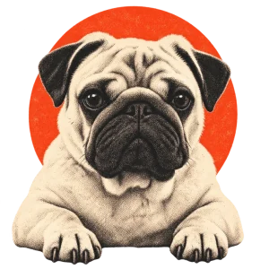
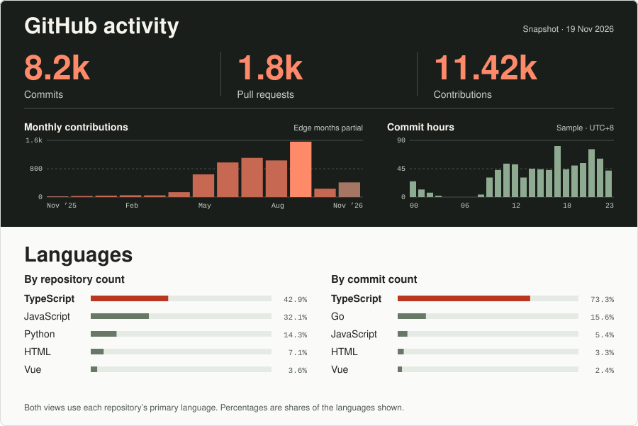

# Dogtiti

I build AI apps, developer tools, and workflow automation.

 

<a href="./profile-summary-card-output/github">
  <picture>
    <source media="(max-width: 900px) and (prefers-color-scheme: dark)" srcset="./assets/profile-dashboard-compact-dark.svg">
    <source media="(max-width: 900px)" srcset="./assets/profile-dashboard-compact-light.svg">
    <source media="(prefers-color-scheme: dark)" srcset="./assets/profile-dashboard-dark.svg">
    
  </picture>
</a>

## What I build

- **TypeScript** — I contribute AI chat features to NextChat and build tools for inspecting React apps. [NextChat](https://github.com/ChatGPTNextWeb/NextChat/pull/5786) · [Vite plugin](https://github.com/Dogtiti/vite-plugin-react-mcp)
- **Go** — I contribute to ViceMe CLI, including tooling for exporting AI agent skill packages. [ViceMe CLI](https://github.com/ViceMe-AI/cli/pull/432)
- **JavaScript** — I build DeepSeek Harness plugins for next-prompt suggestions and input history. [dsh-predict](https://github.com/Dogtiti/dsh-predict) · [dsh-input-history](https://github.com/Dogtiti/dsh-input-history)
- **Python** — I use small Python scripts in end-to-end checks of agent skill delivery. [Delivery smoke test](https://github.com/Dogtiti/viceme-agent-e2e)

